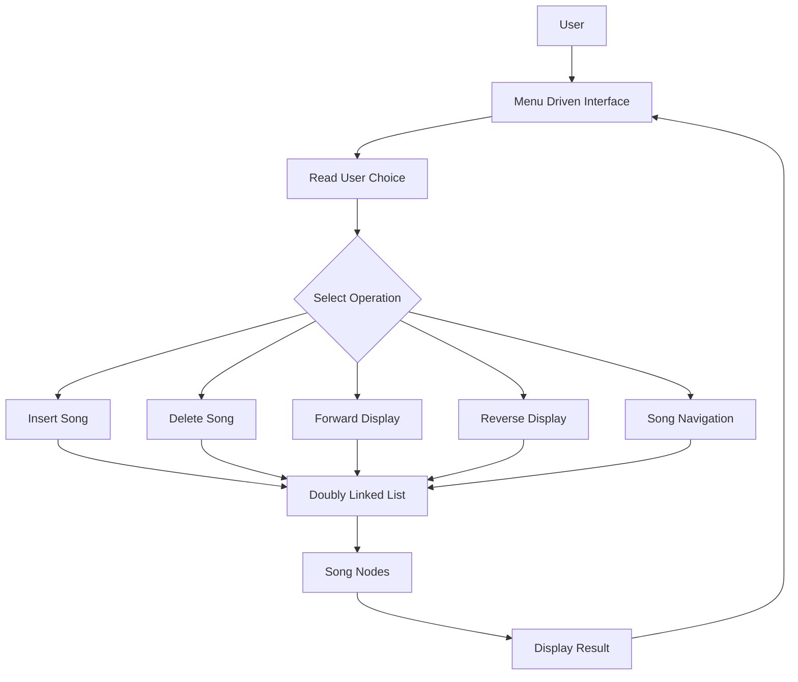
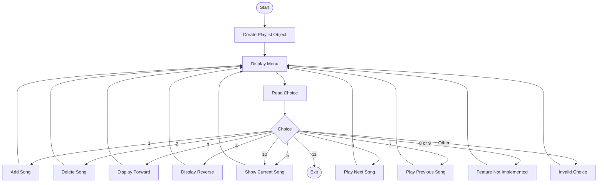

# Music Playlist Manager Using Doubly Linked List

## 1. Project Overview

The Music Playlist Manager is a menu-driven application developed using C++. It uses a Doubly Linked List data structure to store and manage songs.

Each song node stores the song title, artist name, pointer to the previous song, and pointer to the next song. This structure supports traversal in both forward and backward directions.

## 2. Objectives

- To understand the implementation of a Doubly Linked List in C++.
- To perform insertion and deletion operations on song nodes.
- To display the playlist in forward and reverse order.
- To navigate between the current, next, and previous songs.
- To understand dynamic memory allocation and pointer manipulation.

## 3. Technologies Used

- **Programming Language:** C++
- **Data Structure:** Doubly Linked List
- **IDE:** Visual Studio Code
- **Version Control:** Git and GitHub

## 4. Features

1. Add a song to the playlist.
2. Delete a song by title.
3. Display the playlist in forward order.
4. Display the playlist in reverse order.
5. Show the current song.
6. Navigate to the next song.
7. Navigate to the previous song.
8. Exit the program.

**Note:** The menu options for playing the complete playlist and repeating all songs are currently placeholders and require further implementation.

## 5. Doubly Linked List Node Structure

Each song is represented by a node containing four members:

- `prev`: Pointer to the previous song.
- `title`: Stores the song title.
- `artist`: Stores the artist name.
- `next`: Pointer to the next song.

### Node Diagram

```text
+----------+----------------------+----------+
|   prev   | Song Information     |   next   |
+----------+----------------------+----------+
             | title              |
             | artist             |
             +--------------------+
```

### Example Playlist

```text
NULL
  |
  v
+----------+----------------+----------+
|   NULL   | Shape of You    |    *     |
+----------+----------------+----------+
                                      |
                                      v
+----------+----------------+----------+
|    *     | Perfect         |    *     |
+----------+----------------+----------+
             ^                        |
             |                        v
+----------+----------------+----------+
|    *     | Believer        |   NULL   |
+----------+----------------+----------+
```

Here, each `*` represents a pointer to a neighboring node. The first node has no previous node, and the last node has no next node.

## 6. Block Diagram



## 7. Program Flowchart



## 8. Algorithms

### A. Insertion Algorithm

1. Create a new song node.
2. If the playlist is empty, set `head` and `current` to the new node.
3. Otherwise, traverse the list to the last node.
4. Set the last node's `next` pointer to the new node.
5. Set the new node's `prev` pointer to the last node.

### B. Deletion Algorithm

1. Search for the node containing the specified song title.
2. If the song is not found, report that it does not exist.
3. If the song is the first node, update `head`.
4. Otherwise, reconnect the previous and next nodes.
5. Delete the selected node and update any affected pointers.

**Implementation note:** The current `remove()` function needs correction before all deletion cases can be considered reliable.

### C. Forward Traversal Algorithm

1. Start from `head`.
2. Display the title of the current node.
3. Move to the next node using `next`.
4. Continue until the pointer becomes `NULL`.

### D. Reverse Traversal Algorithm

1. Start from `head`.
2. Move to the last node using `next`.
3. Display the current node's title.
4. Move backward using `prev`.
5. Stop when the pointer becomes `NULL`.

### E. Song Navigation Algorithm

1. Check whether `current` is `NULL`.
2. If it is `NULL`, display that the playlist is empty.
3. For next-song navigation, move using `current->next` if available.
4. For previous-song navigation, move using `current->prev` if available.
5. Display the selected song.

## 9. Time Complexity

Let `n` represent the number of songs.

| Operation | Time Complexity |
|---|---|
| Check empty playlist | O(1) |
| Insert song at end | O(n) |
| Delete song by title | O(n) |
| Display forward | O(n) |
| Display backward | O(n) |
| Navigate next/previous | O(1) |

These complexities describe the intended operations; deletion must be corrected to handle all cases safely.

## 10. How to Compile and Run

### Using a C++ Compiler

1. Install a C++ compiler such as GCC.
2. Open a terminal in the project folder.
3. Compile the program:

```bash
g++ menudriven.cpp -o playlist
```

4. Run the program on Windows:

```bash
playlist.exe
```

If necessary, run it from Command Prompt using:

```bash
.\playlist.exe
```

## 11. Sample Menu

```text
===== MUSIC PLAYLIST =====
1. Add Song
2. Delete Song
3. Display Playlist in Forward
4. Display Playlist in Reverse
5. Play Current Song
6. Play Next Song
7. Play Previous Song
8. Play Complete Playlist
9. Repeat All
10. Show Current Song
11. Exit

Enter your choice:
```

## 12. Limitations and Future Improvements

- Correct deletion for empty, single-node, first-node, middle-node, and last-node cases.
- Update the current-song pointer safely after deletion.
- Add support for song titles and artist names containing spaces.
- Implement complete-playlist playback.
- Implement repeat-all functionality.
- Add song searching and playlist saving to a file.
- Improve input validation and empty-playlist handling.

## 13. Conclusion

The Music Playlist Manager demonstrates the practical use of a Doubly Linked List in C++. It helps develop an understanding of nodes, pointers, insertion, deletion, and bidirectional traversal. The project provides a foundation for developing more advanced playlist management applications.

## 14. Author

Developed as a Data Structures and Algorithms case study using C++.

