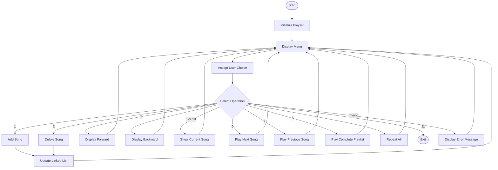
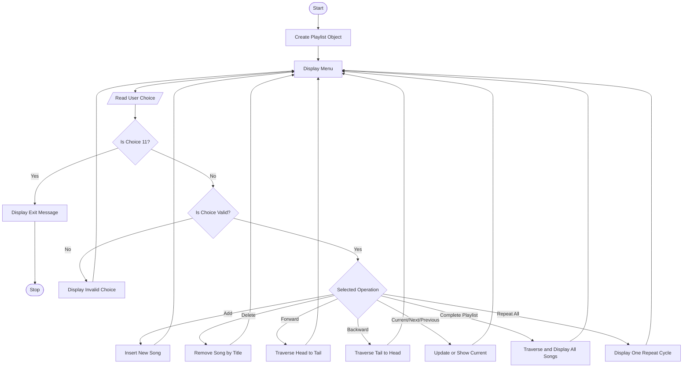

# Music Playlist Manager Using Doubly Linked List in C++

## 1. Project Overview

The Music Playlist Manager is a menu-driven C++ application that manages songs using a **Doubly Linked List** data structure.

Each song stores its title, artist name, and pointers to the previous and next songs. The user can add, delete, display, and navigate songs in the playlist.

This project demonstrates the practical application of linked lists in Data Structures and Algorithms (DSA).

## 2. Objectives

- Understand the implementation of a doubly linked list.
- Perform insertion and deletion of nodes.
- Traverse a linked list in forward and backward directions.
- Navigate between the current, next, and previous songs.
- Apply dynamic memory allocation in C++.
- Develop a menu-driven application.

## 3. Technologies Used

- **Programming Language:** C++
- **Data Structure:** Doubly Linked List
- **IDE:** Visual Studio Code
- **Compiler:** GCC (g++)
- **Version Control:** Git and GitHub

## 4. Features

1. Add a new song to the playlist.
2. Delete a song by title.
3. Display songs in forward order.
4. Display songs in reverse order.
5. Play or show the current song.
6. Navigate to the next song.
7. Navigate to the previous song.
8. Display the complete playlist as a simulated playback.
9. Repeat all songs for one simulated cycle.
10. Show the current song.
11. Exit the application.

**Note:** This project simulates playback through console output. It does not play actual audio files.

## 5. Doubly Linked List Node Structure

Each node contains three main fields:

- `prev`: Pointer to the previous song.
- `title` and `artist`: Information about the song.
- `next`: Pointer to the next song.

### Node Diagram

```text
+-------------+-------------------+-------------+
|    prev     |  Song Information |    next     |
+-------------+-------------------+-------------+
```

### Example of a Playlist

```text
head
 |
 v
NULL <- [Song A] <-> [Song B] <-> [Song C] -> NULL
          ^              ^              ^
          |              |              |
       Previous      Current/Next     Next Song
```

The `current` pointer identifies the song currently selected by the program.

## 6. Block Diagram

The following diagram represents the main modules of the Music Playlist Manager.



## 7. Program Flowchart

The following flowchart shows the overall execution of the program.



## 8. Algorithms

### Algorithm 1: Add Song

1. Accept the song title and artist name.
2. Create a new node.
3. If the playlist is empty, set `head` and `current` to the new node.
4. Otherwise, traverse to the last node.
5. Link the last node to the new node.
6. Set the new node's `prev` pointer to the previous last node.
7. Display a success message.

### Algorithm 2: Delete Song

1. Accept the title of the song to delete.
2. Search the playlist for the matching node.
3. If the song is not found, display a message.
4. Otherwise, connect the previous node to the next node.
5. Update `head` if the first node is deleted.
6. Update `current` if the current song is deleted.
7. Delete the node and display a success message.

### Algorithm 3: Display Forward

1. Start from `head`.
2. Display the title and artist of each song.
3. Move to the next node using `next`.
4. Stop when the pointer becomes `nullptr`.

### Algorithm 4: Display Backward

1. Start from `head`.
2. Traverse to the last node.
3. Display the title and artist.
4. Move to the previous node using `prev`.
5. Stop when the pointer becomes `nullptr`.

### Algorithm 5: Play Next or Previous Song

1. Check whether the playlist is empty.
2. If the user selects Next, check `current->next`.
3. If the user selects Previous, check `current->prev`.
4. Move the `current` pointer when navigation is possible.
5. Display the selected song.

### Algorithm 6: Repeat All

1. Check whether the playlist is empty.
2. Start from the first song.
3. Display every song in sequence.
4. Update the current pointer while traversing.
5. Reset the current pointer to the first song after one simulated cycle.

## 9. Time Complexity Analysis

Let `n` be the number of songs in the playlist.

| Operation | Time Complexity |
|---|---|
| Add song | O(n) |
| Delete song | O(n) |
| Display forward | O(n) |
| Display backward | O(n) |
| Play current song | O(1) |
| Play next song | O(1) |
| Play previous song | O(1) |
| Play complete playlist | O(n) |
| Repeat all | O(n) |

**Space Complexity:** O(n), because each song is stored in a separate node.

## 10. Software Requirements

- Windows, Linux, or another supported operating system.
- Visual Studio Code or any C++ IDE.
- GCC C++ compiler.
- Basic knowledge of C++ pointers, classes, and linked lists.

## 11. How to Compile and Run

### Step 1: Open the Project Folder

Open the folder containing `menudriven_corrected.cpp` in Visual Studio Code.

### Step 2: Open the Terminal

Select **Terminal → New Terminal**.

### Step 3: Compile the Program

```bash
g++ -std=c++17 menudriven_corrected.cpp -o music
```

### Step 4: Run the Program

On Windows:

```bash
.\music.exe
```

On Linux:

```bash
./music
```

## 12. Sample Output

## 13. Output Screenshots

## 13. Output Screenshots

### 1. Add Song


### 2. Complete Playlist


### 3. Current Song


### 4. Delete Song


### 5. Forward Playlist


## 13. Advantages

- Supports navigation in both directions.
- Allows insertion and deletion of songs.
- Uses dynamic memory allocation.
- Demonstrates a practical use of linked lists.
- Provides a simple and interactive menu.

## 14. Limitations

- Does not play real audio files.
- Songs are not saved permanently after the program closes.
- Songs are searched and deleted using their titles.
- The Repeat All operation simulates one cycle only.

## 15. Future Scope

- Integrate audio playback using an audio library.
- Store playlists in a file or database.
- Add search and sorting features.
- Support multiple playlists.
- Add shuffle and continuous repeat modes.
- Develop a graphical user interface.

## 16. Learning Outcomes

Through this project, we learn:

- Doubly linked list implementation.
- Pointer manipulation and node connections.
- Insertion, deletion, and traversal operations.
- Dynamic memory management.
- Menu-driven programming in C++.
- Practical application of DSA concepts.

## 17. Conclusion

The Music Playlist Manager demonstrates how a doubly linked list can be used to manage a collection of songs efficiently. It supports adding, deleting, displaying, and navigating songs in both directions. This project strengthens the understanding of pointers, linked lists, dynamic memory allocation, and object-oriented programming in C++.

## 18. Author

**Project:** Music Playlist Manager Using Doubly Linked List  
**Subject:** Data Structures and Algorithms (DSA)  
**Language:** C++  
**Platform:** GitHub
